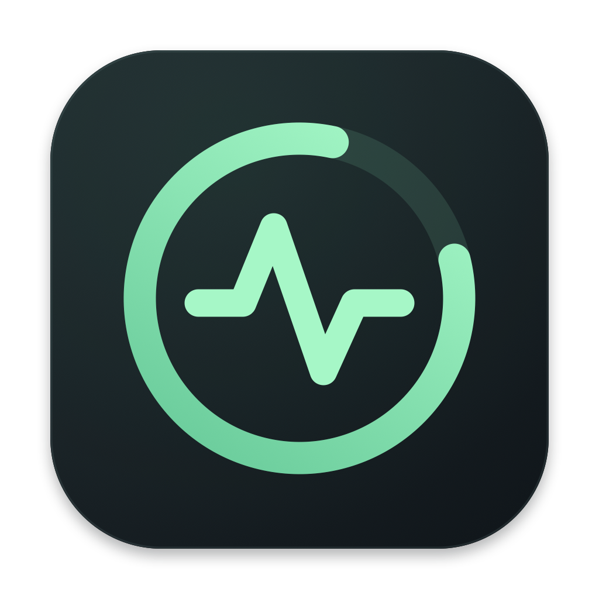

# Codex Monitor



查看当前 Codex 账户、周额度和 Mac 系统资源的原生 macOS 应用。带有 Dock 图标、菜单栏入口和可拖动的置顶面板，支持位置记忆与多桌面。

这是独立的第三方工具，与 OpenAI 无隶属关系。可把面板放在 Codex 内置宠物旁边；不会自动跟随宠物移动。

## 下载与安装

从 [最新 GitHub Release](https://github.com/WinglokWong/codex-monitor/releases/latest) 下载 `Codex-Monitor-1.1.0-universal.dmg`，打开后将 **Codex Monitor.app** 拖入 **Applications**，再从应用程序目录启动。

- macOS 13 及以上，Universal 二进制支持 Apple Silicon 和 Intel。
- 已在 macOS 26 / Apple Silicon 实机验证；Intel 构建已完成，尚未在 Intel Mac 实机验证。
- 本版本采用 ad-hoc 本地签名，尚未经过 Apple Developer ID 签名和公证。macOS 可能阻止首次打开；确认下载来源后，可按系统提示在「系统设置 → 隐私与安全性」批准打开。无需关闭 Gatekeeper。
- Release 同时附带 `SHA256SUMS.txt`，可校验下载文件。
- 额度查询需要本机安装 Codex 桌面应用或 CLI，并已登录 ChatGPT 账户；桌面主应用无须保持运行。没有 Codex 时仍可查看系统资源。

## 使用

安装后点击 Dock 或应用程序目录里的 **Codex Monitor** 图标。源码目录也提供 `启动监控.command`，可自动构建并打开 `build/Codex Monitor.app`。

- 拖动面板标题或空白处改变位置。
- 右上角刷新按钮立即重新查询账户与额度。
- `…` 菜单可切换置顶、隐藏面板或退出。
- 隐藏后，点击 Dock 图标恢复；也可点击 macOS 菜单栏的波形图标，选择「显示面板」。
- Dock 图标右键菜单提供「显示监控面板」「刷新额度」；应用菜单支持 `⌘R` 刷新、`⌘1` 显示面板、`⌘Q` 退出。
- 不自动设置开机启动。退出监控会停止定时采样和额度查询。

应用使用 AppKit、SwiftUI 和系统原生接口，无需 npm、Python 或第三方运行时。

## 显示内容

| 指标 | 更新频率 | 说明 |
| --- | --- | --- |
| 当前账户与套餐 | 每 60 秒 | 使用与额度查询相同的本地 Codex CLI；邮箱脱敏显示，缺失邮箱显示为无邮箱信息 |
| 周额度剩余百分比 | 每 60 秒 | 使用服务端的 10080 分钟窗口；支持周窗口位于 primary 或 secondary，多额度池时可切换 |
| 重置时间与倒计时 | 倒计时每秒计算 | 明确使用北京时间 Asia/Shanghai；重置后等待服务端确认，不自行假定恢复为 100% |
| CPU | 每秒 | 整机所有 CPU 的忙碌时间比例，范围 0–100% |
| 内存 | 每秒 | 物理使用估算及 GiB；排除文件缓存，计入实际压缩占用，可能与活动监视器略有差异 |
| 下载／上传 | 每秒 | 活动物理以太网和 Wi-Fi 网卡合计；字节/秒，1024 进制 KiB/s、MiB/s |

网络统计含局域网流量和 VPN 外层传输开销，排除回环、VPN 虚拟接口、AWDL 和桥接接口，避免重复计数。首次采样、断网、换网卡或唤醒后可能短暂显示 `—`，随后建立新基线。无数据不显示为 0。

账户与额度来自同一次本地 CLI 查询流程。若 CLI 和桌面应用使用了不同的登录账户，面板显示的是 CLI 当前账户。应用没有新增登录或切换账户界面；在现有 Codex CLI 中更换登录后，下一次成功刷新会显示新的账户与额度。

刷新失败时会清空旧账户和旧额度，并显示不可用及错误状态，避免把上一个账户的数据当成当前数据；把鼠标停在底部状态上可查看错误。API key 模式和未登录状态会分别标明；邮箱未知或为 `null` 时显示无邮箱信息，不猜测账户身份。没有周窗口的账户显示周额度暂不可用。

账户行仅显示脱敏邮箱。账户查询涉及的原始邮箱仅在内存中处理，不写入持久化文件或仓库；token 由 Codex 管理，监控程序不读取或保存 token。仓库中的账户测试样例均使用虚构数据。

## 编译与检查

需安装 Xcode Command Line Tools：

```sh
./build.sh
"build/Codex Monitor.app/Contents/MacOS/CodexMonitor" --self-test
python3 Tests/test-quota-protocol.py
"build/Codex Monitor.app/Contents/MacOS/CodexMonitor" --probe
./scripts/package-release.sh
```

`--self-test` 检查账户字段与邮箱脱敏、额度字段解析、过期和缺失值、CPU 计数回绕、网络接口变化及计数器重置、时区和显示单位，不访问网络。`--probe` 输出一次真实系统及账户／额度查询结果；不要在无法启动 Codex 子进程的受限沙箱内运行它。

可选的 Python 协议测试用模拟 CLI 检查账户切换、身份确认和异常响应，不连接真实账户或网络；应用运行本身不需要 Python。

构建脚本使用 Release 优化，为 `arm64` 和 `x86_64` 分别编译，再合成为 Universal 应用并进行本地 ad-hoc 签名。打包脚本验证架构、签名和自测，生成 `dist/` 下的 DMG 与 SHA-256 校验文件；不包含 Codex CLI、账户凭据或本机代理配置。

图标由 `scripts/generate-icon.swift` 使用原生矢量绘图生成。需要指定非标准 CLI 路径时，可在直接启动程序的环境中设置 `CODEX_MONITOR_CLI=/absolute/path/to/codex`。

## 实现

- `Sources/QuotaClient.swift`：独立启动 `codex app-server --listen stdio://`，完成初始化后调用 `account/read` 与 `account/rateLimits/read`，20 秒超时。只读取账户信息和额度，不创建模型对话，不消费重置次数。认证由 Codex 自行管理，面板不读取或保存 token，也不保存原始认证日志。
- `Sources/SystemMetrics.swift`：Mach CPU / VM 计数器和 `NET_RT_IFLIST2` 64 位网卡统计。内存估算公式为 `(max(internal − purgeable, 0) + wired + physical compressor) × page size`。
- `Sources/MonitorModel.swift`、`MonitorView.swift`、`main.swift`：刷新、显示、浮动窗口、菜单栏入口及位置记忆。

官方 [Pets 文档](https://learn.chatgpt.com/docs/pets?surface=app) 没有列出向内置宠物注入实时自定义指标的公开接口，因此采用独立面板。[Codex App Server 文档](https://learn.chatgpt.com/docs/app-server) 定义了额度读取接口与字段；该接口可能随 Codex 版本演进。
